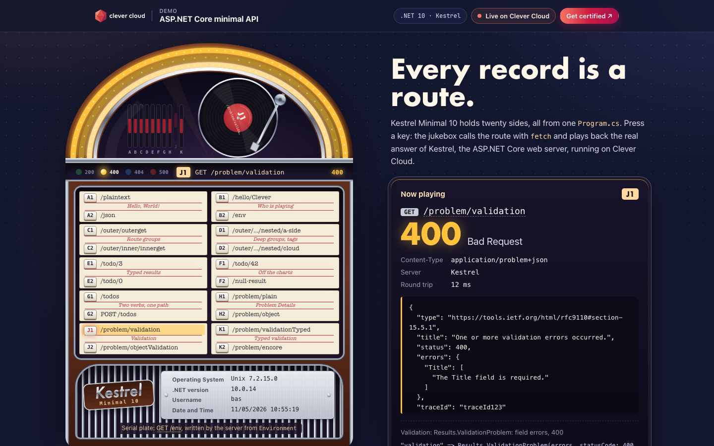
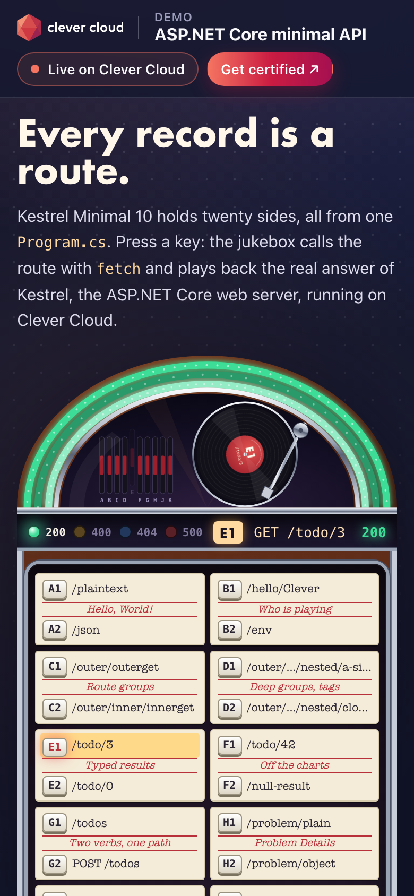

# Kestrel Jukebox — ASP.NET Core minimal API on Clever Cloud

> A jukebox whose ten records, twenty sides in all, are the routes of one `Program.cs`. Press a key: the arm drops the record, the page calls the route with `fetch`, and the jukebox shows the real HTTP answer from Kestrel, the ASP.NET Core web server: status code, `Content-Type`, body, and the C# line that produced it. The tubes and the four lamps light up green for 200, amber for 400, blue for 404, red for 500. The serial plate on the base is the machine that plays: operating system, .NET version, user and date, read by the server. On Clever Cloud the **native .NET runtime** finds the single `.csproj`, publishes it in Release with .NET 10 (LTS), and the app listens on port 8080: no Dockerfile, no add-on, two variables (the .NET version and the health check).





**Run it yourself.** The hosted demo was taken down after the presales review (November 2026). The steps in [Deploy on Clever Cloud](#deploy-on-clever-cloud) recreate it from scratch in about 5 minutes.

**Get certified.** This demo runs on Clever Cloud. To deploy your own apps the same way, get certified at the [Clever Cloud Academy](https://academy.clever.cloud/).

## What ASP.NET Core does here

Each title strip is a record, each of its two sides is a selection key (letters skip I, as on the old jukeboxes). Click a key, or type its code on the keyboard (`E` then `2`).

| Key | Route | Minimal API feature | What you get (checked on Clever Cloud with .NET 10, 5 November 2026) |
|---|---|---|---|
| A1, A2 | `GET /plaintext`, `GET /json` | A string becomes `text/plain`, an object becomes JSON | `Hello, World!` · `{"message":"Hello, World!"}` |
| B1 | `GET /hello/{name}` | Route parameter; the name comes from the dedication card | `Hello, Clever!` for `/hello/Clever` |
| B2 | `GET /env` | The original home route, a raw interpolated string from `Environment` | `Operating System`, `.NET version`, `Username`, `Date and Time` (server time, server culture), `text/plain`. The serial plate reads it |
| C1, C2 | `/outer/outerget`, `/outer/inner/innerget` | `MapGroup`, two `AddEndpointFilterFactory` on the inner group | `I'm nested.` · `I'm more nested. \| nested filter! \| /inner filter! Tags: (null)` |
| D1, D2 | `/outer/inner/group/{groupName}/nested/{nestedName}` | Groups four levels deep, two route parameters, `WithTags` | `Hello from jukebox:a-side! \| nested filter! \| /inner filter! Tags: nested, more, tags` |
| E1, E2, F1 | `GET /todo/{id}` | `Results<Ok<Todo>, NotFound, BadRequest>` typed results | `/todo/3`: `{"id":3,"title":"Walk the dog"}`; `/todo/0`: 400; `/todo/42`: 404 |
| F2 | `GET /null-result` | A handler returning `null` | 500, empty body |
| G1, G2 | `GET /todos`, `POST /todos` | A JSON list; `IBindableFromHttpContext<T>`: the type binds itself | Two todos · whatever the body: `{"id":1,"title":"I was bound from IBindableFromHttpContext<TodoBindable>.BindAsync!","isComplete":false}` |
| H1, H2 | `/problem/plain`, `/problem/object` | `Results.Problem` | 500, `application/problem+json`, `"traceId":"traceId123"` |
| J1, J2, K1 | `/problem/validation`, `/problem/objectValidation`, `/problem/validationTyped` | `Results.ValidationProblem`, `HttpValidationProblemDetails`, `TypedResults.ValidationProblem` | 400, `application/problem+json`, `"The Title field is required."` |
| K2 | `/problem/encore` | Any other problem type | 404 |

The page itself is static: `wwwroot/index.html`, `jukebox.css` and `jukebox.js`, served by `UseDefaultFiles` and `UseStaticFiles`. A strict Content Security Policy (`script-src 'self'; style-src 'self'`, no inline code) and `X-Content-Type-Options: nosniff` come with every answer, except the unhandled 500 of `/null-result`: Kestrel clears the headers when the handler throws. The "Running on Clever Cloud" card reads `GET /platform`, which returns seven platform variables and nothing else (`CC_APP_NAME`, `APP_ID`, `INSTANCE_NUMBER`, `INSTANCE_TYPE`, `CC_PRETTY_INSTANCE_NAME`, `CC_COMMIT_ID`, `CC_DEPLOYMENT_ID`); off the platform it shows "Local". The gold record on the wall leads to the Clever Cloud Academy certification.

The app logs its process ID at startup, then `Building filter!` and `Running filter!` from the endpoint filters, on stdout: `clever logs` shows them.

## Deploy on Clever Cloud

You need [clever-tools](https://www.clever.cloud/developers/doc/cli/) (`clever login` done) and the ID of the organisation that will own the resources (`orga_…`, shown in the Console). Run the commands from the repo root: `clever create` links the folder to the new app.

```bash
# 1. The app and its size (.NET compiles: dedicated M build instance)
clever create --type dotnet clevercloud-dotnet-minimal --org <org_id> --region par
clever scale --min-flavor nano --max-flavor XS --min-instances 1 --max-instances 2
clever scale --build-flavor M

# 2. Variables
clever env set CC_DOTNET_VERSION 10.0
clever env set CC_HEALTH_CHECK_PATH /plaintext

# 3. Deploy
clever deploy
clever open
```

No add-on, no secret, no setup script. Clever Cloud detects the single `.csproj` and builds with `dotnet publish --framework net10.0 --runtime exherbo-x64 --configuration Release MinimalSample.csproj`; `wwwroot/` is published with it.

The app must listen on `0.0.0.0:8080`: `appsettings.json` sets `"Urls": "http://0.0.0.0:8080"`. Without it, Kestrel binds `localhost:5000` and the deploy fails its health check after about 4 minutes ("Your application is not listening on 8080"), as seen on 4 November 2026.

**.NET 10 (LTS).** The project targets `net10.0` and `CC_DOTNET_VERSION` is `10.0`, the value the Clever Cloud docs give for `10.0 (LTS)`: the build log says `Using .NET version 10.0` and SDK 10.0.114, the serial plate reads .NET 10.0.14. .NET 8, the previous target, reaches end of support on 10 November 2026. The migration changed no line of `Program.cs` (the project has no NuGet package to update): every route still answers as the table above says, status, `Content-Type` and body. Tested on Clever Cloud on 5 November 2026 (one nano instance, M build): `clever deploy` took 58 s, the domain answered 77 s later, `tests/smoke.sh` passed 26 of 26.

## Variables

| Variable | Set by | Role |
|---|---|---|
| `CC_DOTNET_VERSION` | you | `10.0`: the .NET SDK and runtime that build and run the app, to match `net10.0` in `MinimalSample.csproj`. The build log says `Using .NET version 10.0` |
| `CC_HEALTH_CHECK_PATH` | you | `/plaintext`, which answers `200 Hello, World!`. "If these paths don't return a 2xx response code, the deployment fails." |
| `ASPNETCORE_URLS` | nobody | Not set on Clever Cloud: on the instance, 5 November 2026, the Kestrel process had no `ASPNETCORE_*` variable, and `PORT=8080`, which the code does not read. Kestrel listens on `0.0.0.0:8080` because of `Urls` in `appsettings.json` |
| `CC_APP_NAME`, `APP_ID`, `INSTANCE_NUMBER`, `INSTANCE_TYPE`, `CC_PRETTY_INSTANCE_NAME`, `CC_COMMIT_ID`, `CC_DEPLOYMENT_ID` | Clever Cloud | Shown on the "Running on Clever Cloud" card through `GET /platform` (the commit shortened to 7 characters) |
| `CC_DOTNET_PROJ` | optional, not needed | Only "If multiple project files are present in your repository"; the single `MinimalSample.csproj` is detected |

## Routes

`/` (the jukebox) · `/env` (the original plain-text home: OS, .NET version, user, date) · `/platform` · `/plaintext` · `/json` · `/hello/{name}` · `/outer/outerget` · `/outer/inner/innerget` · `/outer/inner/group/{groupName}/nested/{nestedName}` · `/todo/{id}` · `GET /todos` and `POST /todos` · `/problem/{plain|object|validation|objectValidation|validationTyped}` (anything else: 404) · `/null-result`.

## Code tour

```
Program.cs                      the whole server: security headers, static files, /env, /platform, the minimal API routes
wwwroot/index.html              the jukebox: crown with the record mechanism, lamps, title strips, serial plate; wall and footer
wwwroot/jukebox.js              the catalogue of the 20 sides, fetch, the readout, the serial plate and the platform card
wwwroot/jukebox.css             the jukebox's own styles (walnut, chrome, ivory strips, lamp colours, reduced motion)
wwwroot/cc-brand.css, *.svg     the Clever Brand Kit, copied as is (logo, certification badge, favicon)
tests/smoke.sh                  curl on every route: status, Content-Type or body, the CSP header
MinimalSample.csproj            Microsoft.NET.Sdk.Web, net10.0, nullable and implicit usings on
appsettings.json                log levels, AllowedHosts *, Urls http://0.0.0.0:8080 (the port Clever Cloud expects)
appsettings.Development.json    log levels in Development
Properties/launchSettings.json  the dotnet run profile: http://localhost:5000, https://localhost:5001, Development
```

`Program.cs` keeps its .NET Foundation header (MIT) and its sample name. The page uses system fonts only, and no third-party resource: the CSP would block it.

## Run locally

```bash
dotnet run                                                  # launch profile: http://localhost:5000 and https://localhost:5001
dotnet run --no-launch-profile                              # Production, on 0.0.0.0:8080 as on Clever Cloud
tests/smoke.sh http://localhost:8080                        # 26 checks; any base URL works, the Clever domain too
```

Requires the .NET 10 SDK, and curl for the smoke test. Locally, the serial plate shows your own machine and user name, and the platform card says "Local".

MIT License.
